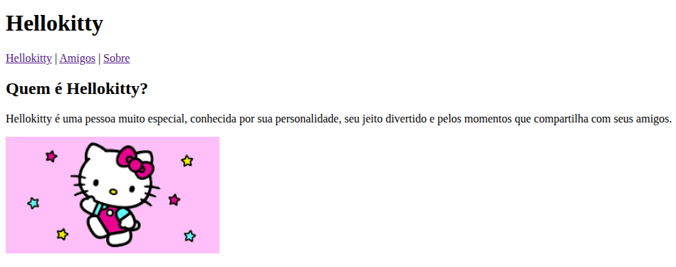
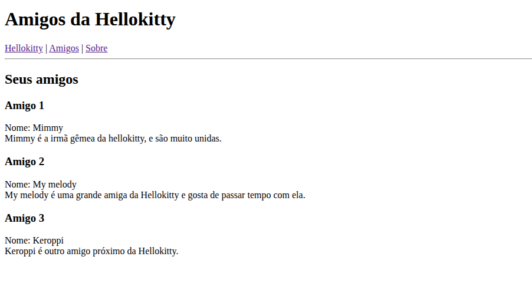
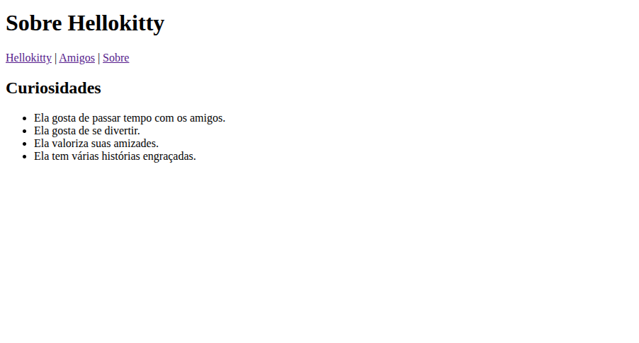

# Hello Kitty — Meu primeiro site em HTML 🎀

Projeto de estudo criado para praticar os primeiros conceitos de **HTML**, como títulos, parágrafos, listas, imagens e links de navegação entre páginas.

O site apresenta a personagem Hello Kitty, alguns de seus amigos e curiosidades sobre ela. A proposta é manter uma estrutura simples, sem estilização adicional, para demonstrar o aprendizado inicial em desenvolvimento web.

## 📄 Páginas do site

- **[Página inicial](index.html):** apresentação da Hello Kitty com texto e imagem.
- **[Amigos](amigos.html):** apresentação de Mimmy, My Melody e Keroppi.
- **[Sobre](sobre.html):** curiosidades sobre a personagem organizadas em uma lista.

As três páginas possuem um **menu de navegação com links funcionais** entre elas.

## 📸 Capturas de tela

### Página inicial

### Página Amigos

### Página Sobre

## 🛠️ Tecnologia utilizada

- **HTML** — estruturação de conteúdo, imagens, listas e links.
